# Capstone-Project---Kubernetes-Cluster-Health-Monitoring-System
Capstone Project by Hero Vired  - Authors : rajkumaramithn , dhruvkapoor604-collab &amp; hitesh-1984-pardeshi


# Kubernetes Cluster Health Checker and Auto-Healing

An automated health monitoring and self-healing tool for Kubernetes clusters. It detects common issues — failed pods, unresponsive nodes, resource pressure — and takes corrective action automatically, reducing the manual overhead for small DevOps teams managing large-scale clusters.

## Problem statement

Manually monitoring and troubleshooting Kubernetes clusters is time-consuming and error-prone, especially for small teams managing large deployments. This project automates detection and recovery of common failure modes to improve availability and reduce operator burden.

## Goals

1. Automated health monitoring of node health, pod status, and resource utilization.
2. Self-healing actions: pod restarts, rescheduling, and scaling to balance workloads.
3. Real-time alerts and notifications for issues requiring manual intervention.
4. A web dashboard showing live health status, historical data, and auto-healing logs.

## Tech stack

| Layer | Tool | Purpose |
|---|---|---|
| Core service | Go | Kubernetes API interaction, performance-critical logic |
| Scripting | Python | Data processing, glue scripts |
| Cluster control | Kubernetes API (client-go) | Read/write access to nodes, pods, deployments |
| Metrics | Prometheus | Cluster and application metric collection |
| Visualization | Grafana | Real-time and historical dashboards |
| Alerting | Alertmanager | Threshold-based alert routing |
| Notifications | Slack API | Delivering alerts to the DevOps team |
| Packaging | Docker | Containerizing the service for deployment |

## Architecture

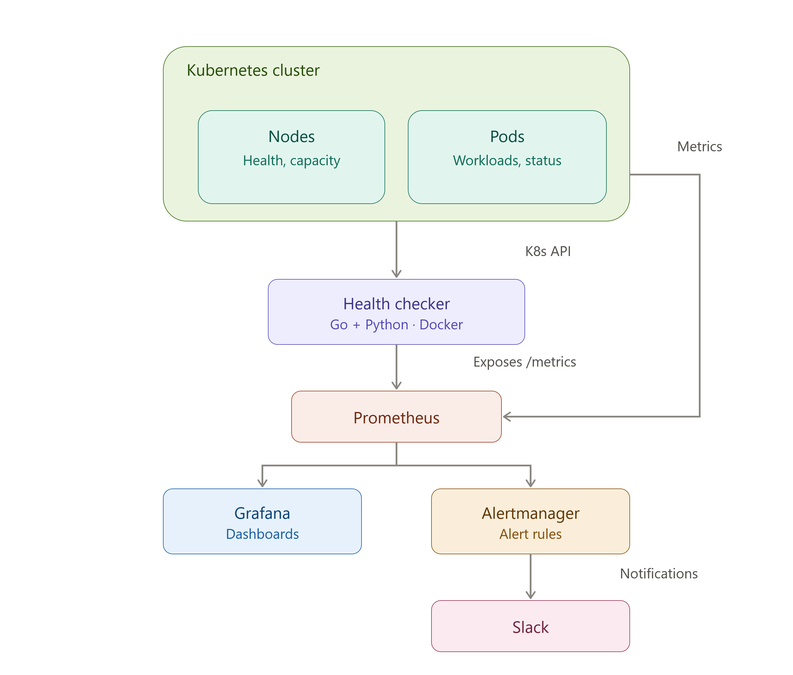


## Kubernetes Cluster (Nodes & Pods)

The environment being monitored by the system. Nodes represent the machines running the cluster and report health conditions such as readiness and resource pressure, while Pods represent the workloads scheduled on them and report status such as running, pending, or failed. This layer is the foundation the entire architecture is built around.

## Health Checker (Go + Python, Docker)

The core application of the project, responsible for watching cluster state and triggering self-healing actions when issues are detected. Go handles direct interaction with the Kubernetes API for performance, while Python supports auxiliary scripting, and Docker packages it for deployment. It connects directly to the cluster via the Kubernetes API and is the only component that actively modifies cluster state.

## Prometheus

The metrics collection layer that scrapes health and resource data from the cluster and the Health Checker at regular intervals, storing it as time-series data. It sits at the center of the observability stack, feeding data to both the visualization and alerting components.

## Grafana

The visualization layer that queries Prometheus to render real-time and historical dashboards of cluster health and auto-healing activity. It connects only to Prometheus and provides the primary interface for reviewing system status.

## Alertmanager

The alert routing layer that evaluates rules against Prometheus data and manages deduplication, grouping, and routing of alerts. It receives triggered alerts from Prometheus and forwards them to the appropriate notification channel based on severity.

## Slack

The notification endpoint that delivers alerts routed through Alertmanager. It connects to the end of the pipeline, surfacing critical issues that may require manual attention.


## Project Execution

## Sprint 1 - Project Setup and Kubernetes Cluster Access

Project File Structure Definition 

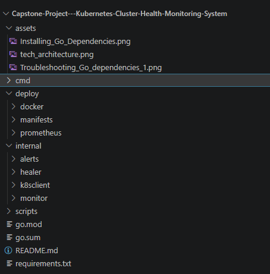

## Step 1 - Initializing the Go Project

<b>On the Command Line Terminal Run :</b>

go mod init Capstone-Project---Kubernetes-Cluster-Health-Monitoring-System
go get k8s.io/client-go@latest
go get k8s.io/apimachinery@latest
go get k8s.io/api@latest
go get github.com/gin-gonic/gin


<b>File Structure Responsibilities</b>

📁 cmd/healer/main.go
</br><i>Entry point (starts everything)</i>

📁 internal/k8sclient
</br><i>Talks to Kubernetes (list pods, get status)</i>

📁 internal/monitor
</br><i>Checks health rules (CrashLoopBackOff detection)</i>

📁 internal/alerts
</br><i>Prints/logs alerts</i>

📁 internal/healer
</br><i>auto-fix logic</i>


## Step 2 - Creating and Setting up the Go Files 

</br><b>Create MAIN ENTRY (cmd/healer/main.go)</b>

Refer to: cmd\healer\main.go

Starts a Kubernetes health monitoring loop that continuously fetches pods from the “default” namespace and checks their status every 10 seconds.
It connects to the cluster using k8sclient, then passes pod data to monitor.CheckPods() for health evaluation and detection of issues.


</br><b>Kubernetes Client (internal/k8sclient)</b>

Refer to: internal\k8sclient\client.go

Creates a Kubernetes client in Go that connects either to a local kubeconfig (Minikube) or in-cluster config, then fetches all pods from a given namespace.
GetPods() uses the Kubernetes API to list pods and returns them so your monitor can check their health status.


</br><b>Monitor Logic</b>

Refer to: internal\monitor\monitor.go

This code:

Loops through all Kubernetes pods and checks each container’s status to detect unhealthy conditions like high restart count or waiting state.
If a problem is found, it prints an alert indicating that the pod is unhealthy (basic health monitoring logic).


</br><b>Alerts Module (simple for Sprint 1)</b>

Refer to: internal\alerts\alerts.go

Creates an alerts package with a function that prints an alert message to the console.
SendAlert() is used to simulate sending notifications when a problem is detected in the Kubernetes cluster.


## Step 3 - Creating the RBAC YAML file for Kubernetes Access

Refer to: deploy\manifests\rbac.yaml


It creates a ServiceAccount + RBAC rules so your app can list and watch pods in the cluster.

---
apiVersion: rbac.authorization.k8s.io/v1
kind: ClusterRole
metadata:
  name: health-monitor-role
rules:
- apiGroups: [""]
  resources: ["pods"]
  verbs: ["get", "list", "watch"]
---
apiVersion: rbac.authorization.k8s.io/v1
kind: ClusterRoleBinding
metadata:
  name: health-monitor-binding
roleRef:
  apiGroup: rbac.authorization.k8s.io
  kind: ClusterRole
  name: health-monitor-role
subjects:
- kind: ServiceAccount
  name: health-monitor-sa
  namespace: default

---

## Sprint 2 - Health Monitoring Module (Node & Pod Checks)

In Sprint 2 the basic pod loop from Sprint 1 becomes a real health monitoring module. The Health Checker now watches both nodes and pods, measures node CPU and memory usage, exposes the results as Prometheus metrics, runs inside the cluster as a container, and raises threshold-based alerts. Prometheus is installed to collect the metrics and Grafana is connected to visualize them.

<b>Cluster used :</b> Minikube (with the metrics-server addon)

<b>Sprint 2 Overview</b>

📁 internal/k8sclient </br><i>Now also lists nodes and reads node CPU and memory usage (Metrics API)</i>

📁 internal/monitor </br><i>Checks pod and node health and exposes Prometheus metrics</i>

📁 cmd/healer </br><i>Runs the metrics endpoint and the monitoring loop</i>

📁 deploy/manifests and deploy/prometheus </br><i>Run the monitor, Prometheus and Grafana inside the cluster</i>

---

## Step 1 - Enabling the Metrics API on Minikube

Node CPU and memory usage are read from the Kubernetes Metrics API, which is provided by the metrics-server addon.

<b>On the Command Line Terminal Run :</b>

minikube start --cpus 2 --memory 2200
minikube addons enable metrics-server
kubectl get nodes
kubectl top nodes

kubectl top nodes can take a minute or two to return values after the addon is enabled.

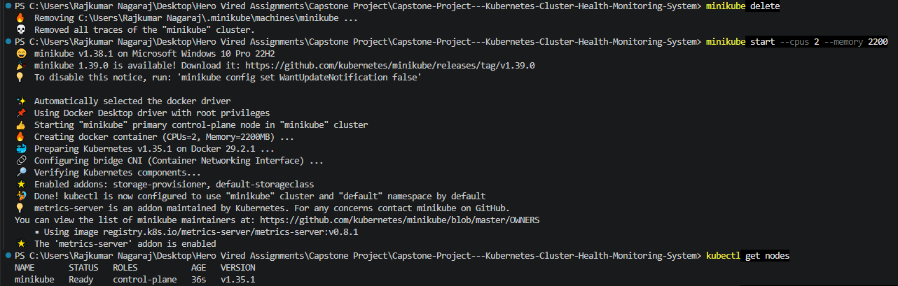

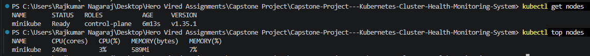

---

## Step 2 - Updating the Kubernetes Client and Adding Node Usage

</br><b>Kubernetes Client (internal/k8sclient)</b>

Refer to: internal\k8sclient\client.go

The client now holds a second client for the Metrics API next to the normal Kubernetes client. A new method, GetNodes(), lists the cluster nodes, and GetNodeMetricsData() reads the current CPU and memory usage of every node so the monitor can calculate utilization.

go
type Client struct {
	set           kubernetes.Interface
	metricsClient metricsclient.Interface
}

// GetNodeMetricsData retrieves node metrics for utilization calculations.
func (c *Client) GetNodeMetricsData() ([]metricsv1beta1.NodeMetrics, error) {
	metrics, err := c.metricsClient.MetricsV1beta1().NodeMetricses().List(
		context.Background(),
		metav1.ListOptions{},
	)
	if err != nil {
		return nil, err
	}

	return metrics.Items, nil
}

The new dependency (k8s.io/metrics) is added to go.mod by running:

go mod tidy

---

## Step 3 - Extending the Monitor Logic

</br><b>Monitor Logic</b>

Refer to: internal\monitor\monitor.go

This code:

CheckPods() now reports pods in the Failed or Unknown phase, containers that restarted more than 3 times, and containers stuck in a waiting state such as ImagePullBackOff. The new CheckNodes() reports nodes that are not Ready and nodes with memory, disk or PID pressure. Every finding is printed through alerts.SendAlert().

go
// CheckNodes checks node readiness and resource-pressure conditions.
func CheckNodes(nodes []v1.Node) {
	for _, node := range nodes {
		for _, condition := range node.Status.Conditions {
			switch condition.Type {
			case v1.NodeReady:
				if condition.Status != v1.ConditionTrue {
					alerts.SendAlert(fmt.Sprintf("Node %s is not ready: %s", node.Name, condition.Message))
				}
			case v1.NodeMemoryPressure, v1.NodeDiskPressure, v1.NodePIDPressure:
				if condition.Status == v1.ConditionTrue {
					alerts.SendAlert(fmt.Sprintf("Node %s has resource pressure: %s", node.Name, condition.Type))
				}
			}
		}
	}
}

---

## Step 4 - Exposing Prometheus Metrics

</br><b>Metrics Module</b>

Refer to: internal\monitor\metrics.go

This file registers the Prometheus metrics and serves them over HTTP. UpdateMetrics(), UpdateNodeMetrics() and UpdateNodeResourceMetrics() refresh the values on every loop.

Metric	Labels	Meaning
kubernetes_health_monitor_pods	namespace, phase	Number of pods per phase
kubernetes_health_monitor_container_restarts	namespace, pod, container	Restart count per container
kubernetes_health_monitor_unhealthy_pods	none	Pods that are failed, unknown, waiting or restarting too often
kubernetes_health_monitor_nodes	node, status	Node readiness (Ready / NotReady / Unknown)
kubernetes_health_monitor_node_pressure	node, condition	1 when memory, disk or PID pressure is active
kubernetes_health_monitor_node_cpu_usage_percent	node	Node CPU utilization
kubernetes_health_monitor_node_memory_usage_percent	node	Node memory utilization
kubernetes_health_monitor_node_scaling_recommendation	node, resource	1 when utilization is 85% or more (used by the scaling work in Sprint 4)

CPU and memory usage are converted into a percentage of the node's capacity:

go
cpuPercent = float64(nodeMetric.Usage.Cpu().MilliValue()) /
	float64(cpuCapacity) * 100

memoryPercent = float64(nodeMetric.Usage.Memory().Value()) /
	float64(memoryCapacity) * 100

The function also prints a WARNING when a node reaches 70% utilization and a SCALE RECOMMENDATION at 85%.


---

## Step 5 - Updating the Main Entry

</br><b>Create MAIN ENTRY (cmd/healer/main.go)</b>

Refer to: cmd\healer\main.go

The main file now does two jobs. It serves the /metrics endpoint on port 8080 in the background, and it runs the monitoring loop every 10 seconds. Each loop fetches pods, nodes and node usage, runs the checks, and refreshes the metrics. It also shuts down cleanly when the container is stopped.

go
for {
	pods := client.GetPods("default")
	nodes := client.GetNodes()

	nodeMetrics, err := client.GetNodeMetricsData()
	if err != nil {
		log.Printf("Error fetching node metrics: %v", err)
	} else {
		monitor.UpdateNodeResourceMetrics(nodes, nodeMetrics)
	}

	monitor.CheckPods(pods)
	monitor.CheckNodes(nodes)
	monitor.UpdateMetrics(pods)
	monitor.UpdateNodeMetrics(nodes)

	// wait 10 seconds, or stop on a shutdown signal
}

Automated pod recovery is not part of this sprint, so the loop does not call the healer package yet. It is added in Sprint 3.


---

## Step 6 - Building and Testing the Code

<b>On the Command Line Terminal Run :</b>

go mod tidy
go build ./...
go test ./...

All packages build without errors and the tests pass.

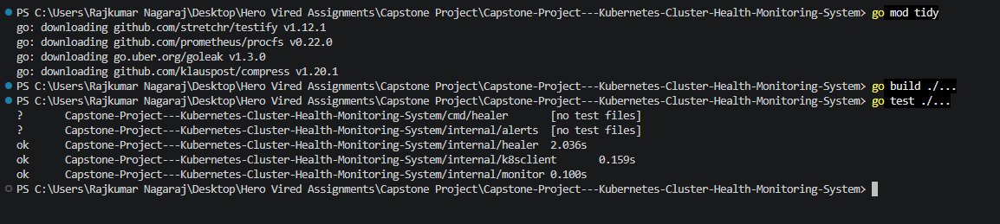

---

## Step 7 - Updating the RBAC YAML file

Refer to: deploy\manifests\rbac.yaml

The ServiceAccount from Sprint 1 now also needs to read nodes and the node metrics API. All permissions are read-only (get, list, watch), following the principle of least privilege.

yaml
rules:
- apiGroups: [""]
  resources: ["pods"]
  verbs: ["get", "list", "watch"]
- apiGroups: [""]
  resources: ["nodes"]
  verbs: ["get", "list", "watch"]
- apiGroups: ["metrics.k8s.io"]
  resources: ["nodes"]
  verbs: ["get", "list", "watch"]

<b>Apply and verify :</b>

kubectl apply -f deploy/manifests/rbac.yaml
kubectl auth can-i list nodes --as=system:serviceaccount:default:health-monitor-sa

The second command prints yes. (The warning that nodes are not namespace scoped is expected, because nodes are cluster-wide.)


---

## Step 8 - Containerizing and Deploying the Health Monitor

Refer to: Dockerfile and deploy\manifests\health-monitor.yaml

The Dockerfile builds the Go program in a build stage and copies only the binary into a small Alpine image that runs as a non-root user and exposes port 8080.

The Deployment runs the monitor with the health-monitor-sa service account, uses /metrics for the readiness and liveness probes, and sets small CPU and memory requests and limits so the monitor uses very little of the cluster (a cost optimization). A Service named health-monitor exposes port 8080 so Prometheus can scrape it.

yaml
resources:
  requests:
    cpu: 50m
    memory: 64Mi
  limits:
    cpu: 100m
    memory: 128Mi

<b>Build the image, load it into Minikube and deploy :</b>

docker build -t health-monitor:latest .
minikube image load health-monitor:latest
kubectl apply -f deploy/manifests/health-monitor.yaml
kubectl apply -f deploy/prometheus/prometheus-deployment.yaml
kubectl apply -f deploy/prometheus/grafana-deployment.yaml
kubectl get pods

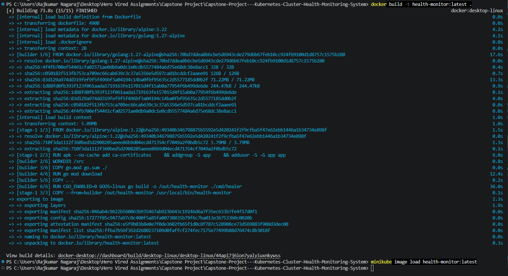

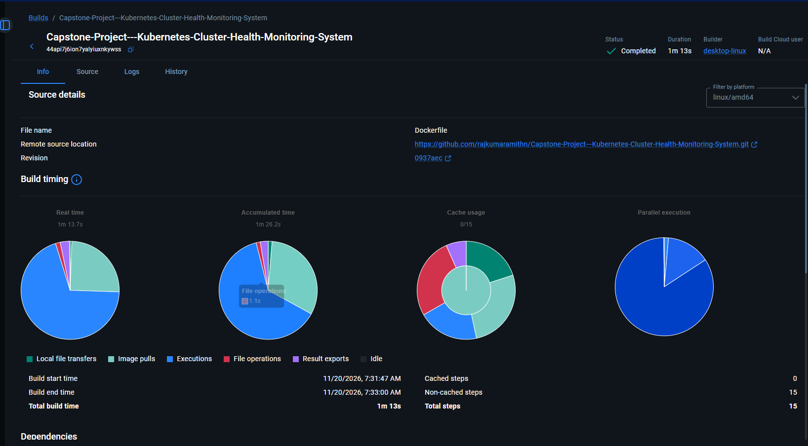

All three pods (health-monitor, prometheus, grafana) reach the Running state. The first start can take a few minutes because the Prometheus and Grafana images have to be downloaded.

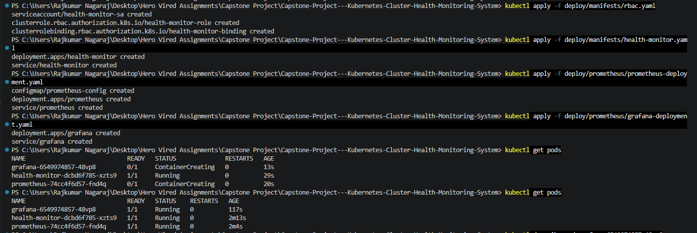

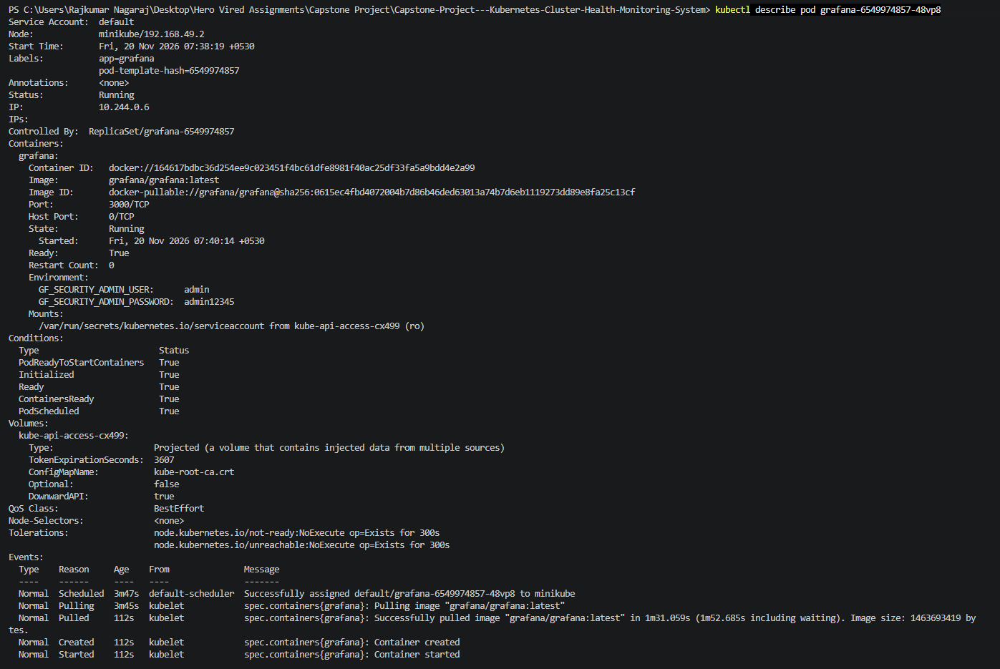

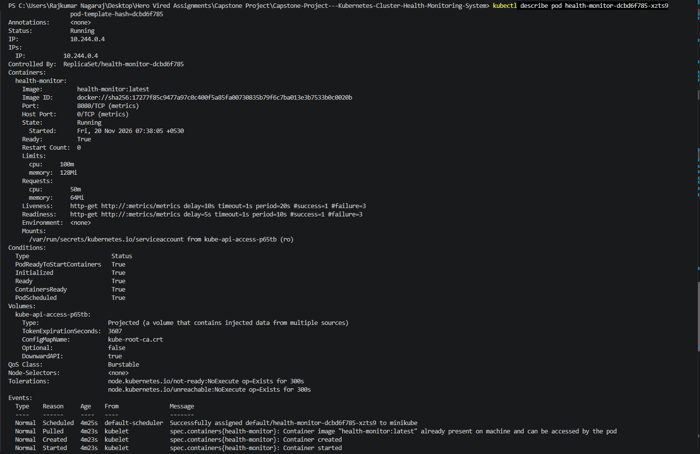

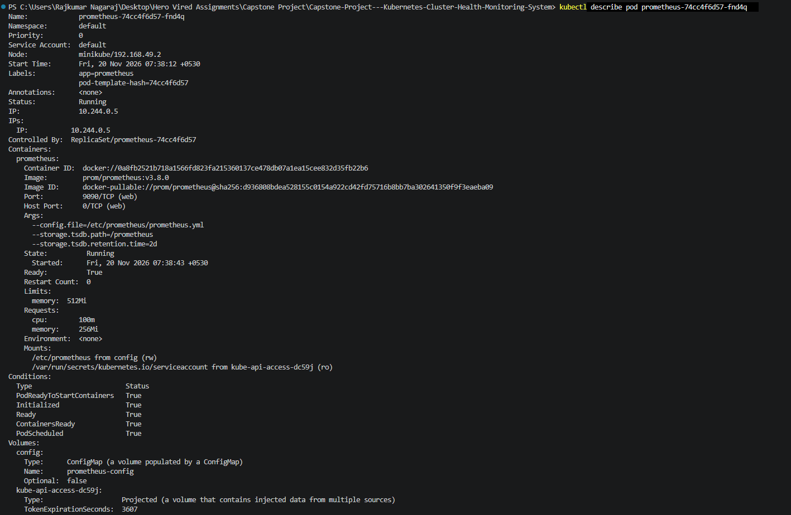

<b>Check the monitor logs :</b>

kubectl logs deploy/health-monitor --tail=5

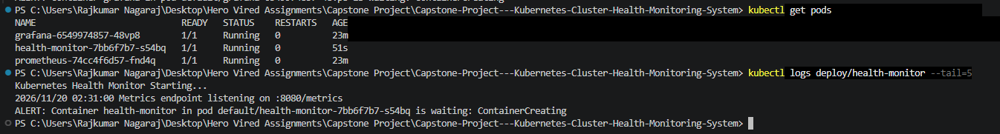

<b>Check the metrics endpoint :</b>

kubectl port-forward svc/health-monitor 18080:8080

Open http://localhost:18080/metrics and search for kubernetes_health_monitor. (Local port 18080 is used because Windows blocked port 8080. Any free local port works.)

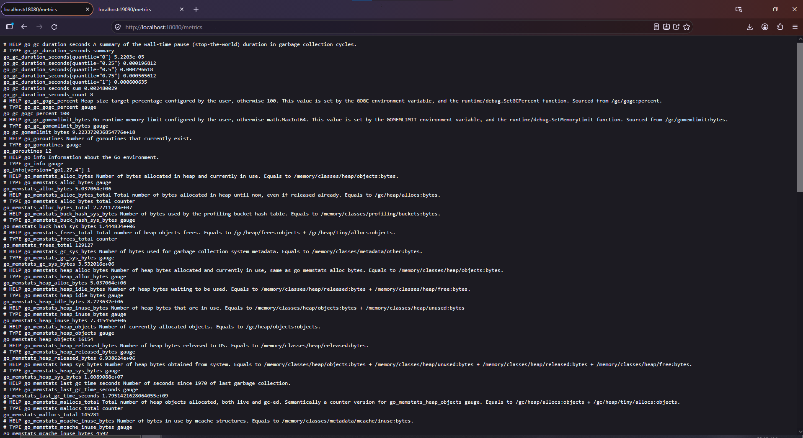

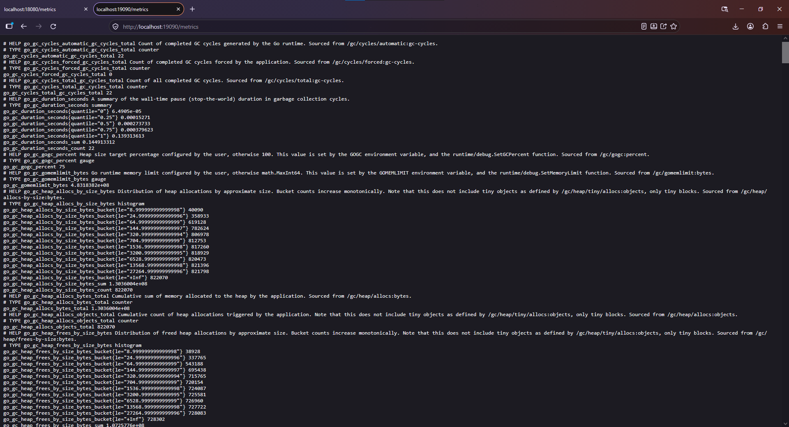

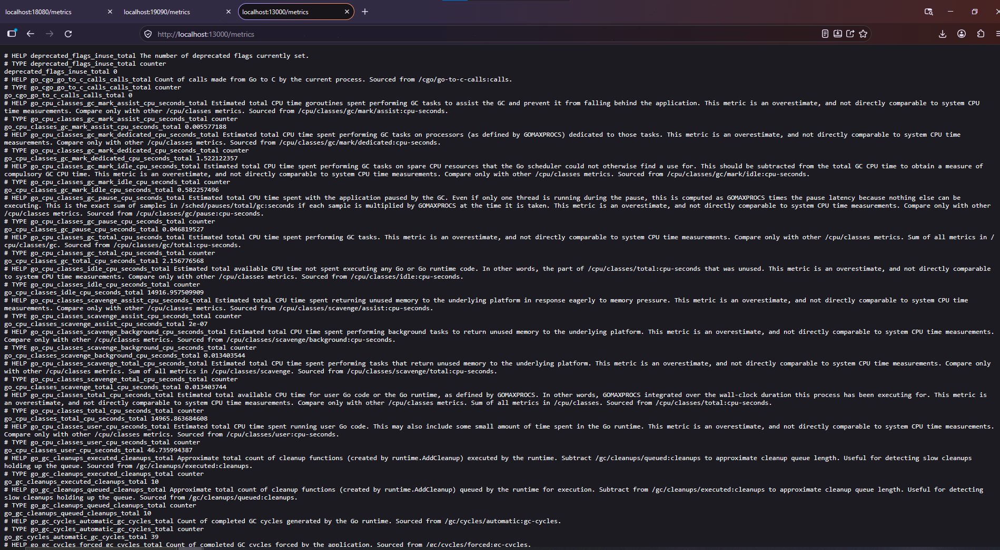


---

## Step 9 - Installing Prometheus with Alert Rules

Refer to: deploy\prometheus\prometheus-deployment.yaml

One file holds everything Prometheus needs: a ConfigMap (scrape settings and alert rules), the Deployment and the Service. Prometheus scrapes itself and the Health Checker every 15 seconds.

yaml
global:
  scrape_interval: 15s
  evaluation_interval: 15s

rule_files:
  - /etc/prometheus/alerts.yml

scrape_configs:
  - job_name: prometheus
    static_configs:
      - targets: ["localhost:9090"]
  - job_name: kubernetes-health-monitor
    metrics_path: /metrics
    static_configs:
      - targets: ["health-monitor:8080"]

Six threshold-based alert rules detect critical health issues:

Alert	Condition	Severity
HealthMonitorDown	Monitor target unreachable for 1 minute	critical
UnhealthyPodsDetected	unhealthy_pods > 0 for 1 minute	warning
KubernetesNodeNotReady	A node is not Ready for 2 minutes	critical
KubernetesNodeResourcePressure	Memory, disk or PID pressure for 2 minutes	warning
HighNodeCPU	Node CPU above 85% for 2 minutes	warning
HighNodeMemory	Node memory above 85% for 2 minutes	warning
yaml
- alert: HighNodeCPU
  expr: kubernetes_health_monitor_node_cpu_usage_percent > 85
  for: 2m
  labels:
    severity: warning
  annotations:
    summary: High node CPU usage
    description: "Node {{ $labels.node }} CPU usage is {{ $value }}%."

Prometheus also runs with small resource limits and keeps only 2 days of data to stay lightweight:

yaml
args:
  - --config.file=/etc/prometheus/prometheus.yml
  - --storage.tsdb.path=/prometheus
  - --storage.tsdb.retention.time=2d
resources:
  requests:
    cpu: 100m
    memory: 256Mi
  limits:
    memory: 512Mi

<b>Open the Prometheus UI :</b>

kubectl port-forward svc/prometheus 9090:9090

Open http://localhost:9090 (use another local port such as 19090 if 9090 is blocked).

Under Status > Targets, both the prometheus and kubernetes-health-monitor jobs show UP.

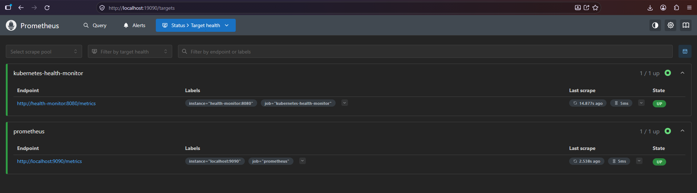

In the Graph tab, running kubernetes_health_monitor_node_cpu_usage_percent shows the node CPU usage.

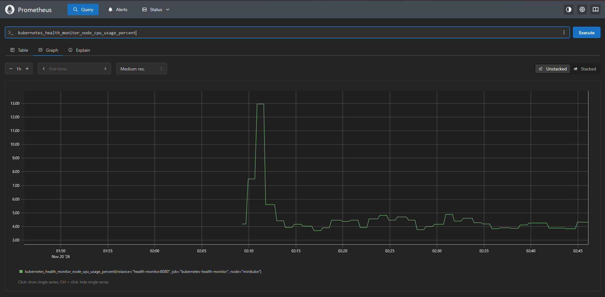

The Alerts page lists the six rules, all inactive while the cluster is healthy.

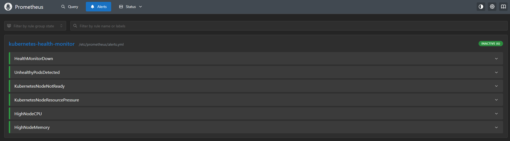

---

## Step 10 - Connecting Grafana

Refer to: deploy\prometheus\prometheus-deployment.yaml and deploy\prometheus\grafana-deployment.yaml

Grafana runs as its own Deployment and Service and only talks to Prometheus.

kubectl port-forward svc/grafana 3000:3000

Open http://localhost:3000 (use another local port such as 13000 if 3000 is blocked) and log in with the admin credentials set in grafana-deployment.yaml. Then:

Go to Connections > Data sources > Add data source > Prometheus.
Set the URL to http://prometheus:9090 and click Save & test. This is the in-cluster address of the Prometheus service.
Grafana confirms with "Successfully queried the Prometheus API".

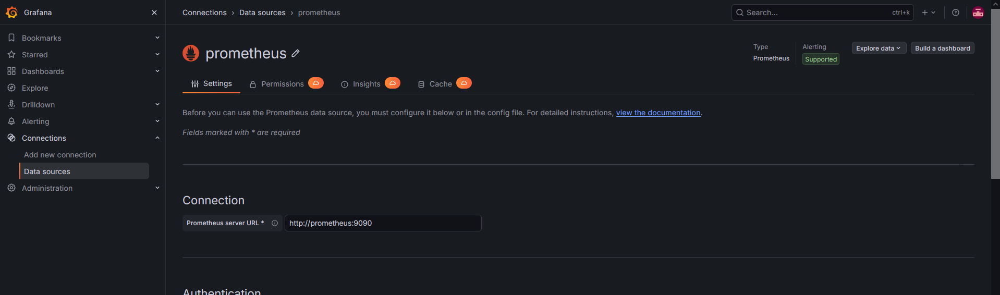


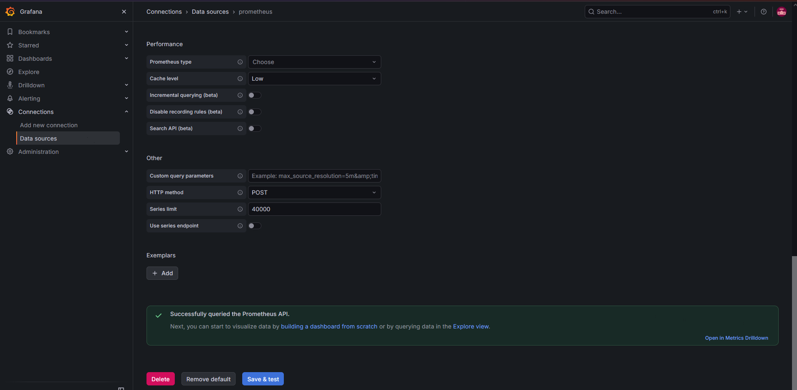

Then create a dashboard named "Cluster Health" with a panel that uses the query kubernetes_health_monitor_node_cpu_usage_percent.

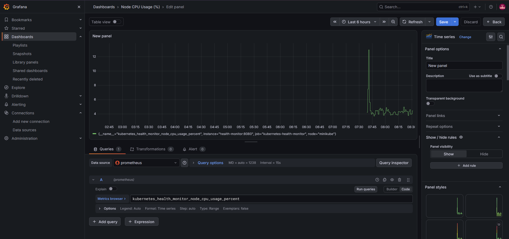


---

## Step 11 - Testing the Alerts

The monitor is tested by creating a pod that can never start, because its image does not exist.

kubectl create deployment bad-pod --image=nginx:doesnotexist
kubectl logs deploy/health-monitor --tail=10

The monitor logs the container as waiting with the reason ImagePullBackOff.

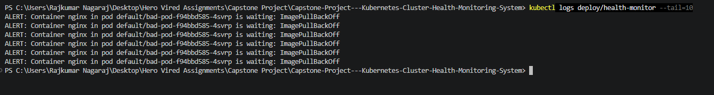

After about a minute the UnhealthyPodsDetected alert changes from Pending to Firing on the Prometheus Alerts page.

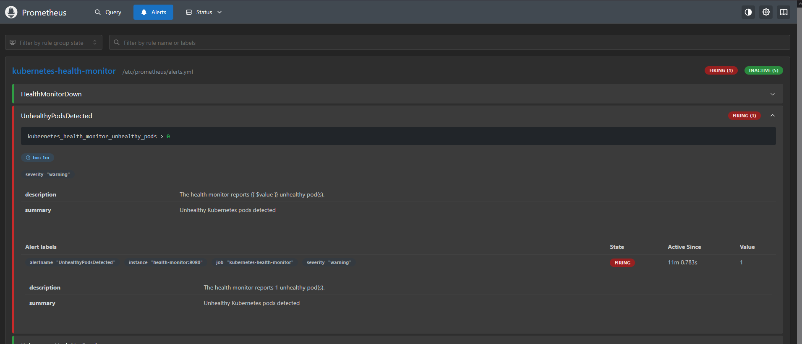

<b>Clean up :</b>

kubectl delete deployment bad-pod

The alert returns to inactive after about a minute.

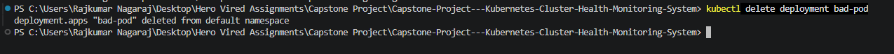


---

## Sprint 2 - Summary of Changes

File	Change

internal/k8sclient/client.go	Added the metrics client, GetNodes() and GetNodeMetricsData()

internal/monitor/monitor.go	Added CheckNodes() and extended CheckPods() (phase, restarts, waiting state)

internal/monitor/metrics.go	Added the Prometheus metrics, CPU and memory percentage calculation and the /metrics handler

cmd/healer/main.go	Runs the metrics endpoint and the monitoring loop with graceful shutdown

go.mod, go.sum	Added the Prometheus client and k8s.io/metrics dependencies

deploy/manifests/rbac.yaml	Read-only access to nodes and the node metrics API

Dockerfile	Multi-stage build running as a non-root user

deploy/manifests/health-monitor.yaml	Deployment, Service, health probes and resource limits

deploy/prometheus/prometheus-deployment.yaml	Prometheus with scrape config, six alert rules, resource limits and 2-day retention

deploy/prometheus/grafana-deployment.yaml	Grafana Deployment and Service

<b>Result :</b> The cluster is monitored for pod and node health, node CPU and memory usage is measured, all data is exposed to Prometheus, Grafana visualizes it, and six threshold-based alerts detect critical problems. The monitor is read-only at this stage.

---

## Sprint 3 - Self-Healing Mechanisms (Pod Recovery)

In Sprint 3 the Health Checker stops only observing and starts acting. When it finds a pod that has failed, been evicted, or is stuck in a crash loop, it removes the pod so that the owning controller (a Deployment or a Job) creates a fresh replacement, which Kubernetes can place on a healthy node. Every action is written to the log with a timestamp and a reason, and is counted as a Prometheus metric, so the recovery is transparent and traceable.

<b>Cluster used :</b> Minikube (local test cluster acting as the staging environment)

<b>Sprint 3 Overview</b>

📁 internal/k8sclient
</br><i>New check that decides why a pod needs healing (Failed, Evicted or CrashLoopBackOff) and a safe deletion method</i>

📁 internal/healer
</br><i>Heals each unhealthy pod and writes an audit log line for every action</i>

📁 internal/monitor
</br><i>New Prometheus counter for healing actions</i>

📁 cmd/healer
</br><i>The monitoring loop now calls the healer</i>

📁 deploy/manifests
</br><i>RBAC permission to delete pods, plus two test workloads</i>

<b>How Self-Healing Works</b>

1. Every 10 seconds the monitor reads the pods in the default namespace.
2. For each pod it asks: is this pod Failed, Evicted, or crash-looping (CrashLoopBackOff with 3 or more restarts)?
3. If yes, the pod is re-read from the API to avoid acting on stale information.
4. The pod is deleted only if it is controller-managed and still the same pod (matching UID).
5. The Deployment or Job controller notices the missing pod and creates a replacement.
6. The action is logged and counted.

Pods that are not managed by a controller are never deleted, because nothing would recreate them.

---

## Step 1 - Deciding Which Pods Need Healing

</br><b>Kubernetes Client (internal/k8sclient)</b>

Refer to: internal\k8sclient\client.go

A new function, UnhealthyReason(), returns the reason a pod should be healed, or an empty string if the pod should be left alone. It covers the three cases in the sprint goal: failed pods, evicted pods (Kubernetes marks them Failed with the reason Evicted) and containers stuck in CrashLoopBackOff after at least 3 restarts.

```go
// UnhealthyReason returns why a pod should be healed, or "" if it should be left alone.
func UnhealthyReason(pod *v1.Pod) string {
	if pod.Status.Phase == v1.PodFailed {
		if pod.Status.Reason == "Evicted" {
			return "Evicted"
		}
		return "Failed"
	}

	for _, cs := range pod.Status.ContainerStatuses {
		if w := cs.State.Waiting; w != nil &&
			w.Reason == "CrashLoopBackOff" &&
			cs.RestartCount >= 3 {
			return "CrashLoopBackOff"
		}
	}

	return ""
}
```

The restart threshold of 3 gives a pod a few chances to recover on its own before the healer steps in.

---


## Step 2 - Deleting Pods Safely

Refer to: internal\k8sclient\client.go

The existing DeleteFailedControllerPod() method already re-read the pod, checked its UID, refused to delete standalone pods, and deleted with a UID precondition. In Sprint 3 only one condition changed: it used to heal only pods in the Failed phase, and now it heals any pod that UnhealthyReason() flags.

<b>Before :</b>

```go
// Confirm that this is still the same pod and is still failed.
if current.UID != pod.UID || current.Status.Phase != v1.PodFailed {
	return false, nil
}
```

<b>After :</b>

```go
// Confirm that this is still the same pod and that it is still unhealthy
// (Failed, Evicted or crash-looping).
if current.UID != pod.UID || UnhealthyReason(current) == "" {
	return false, nil
}
```

The safety checks that remain in the method:

| Safety check | Purpose |
|---|---|
| Re-read the pod before acting | Never act on stale information |
| Compare the UID | Make sure it is still the same pod and not a replacement |
| Require a controller owner | Never delete a standalone pod that nothing would recreate |
| UID precondition on the delete call | Never delete a replacement pod by mistake |

---


## Step 3 - The Healer with an Audit Log

</br><b>Healer (internal/healer)</b>

Refer to: internal\healer\healer.go

HealFailedPods() loops over the pods, asks for the reason, requests the safe deletion, and records what happened. Each action is written with log.Printf, which adds a timestamp, so the log works as the audit trail. Each successful action also increases the healing counter. An error on one pod does not stop the healer from handling the others.

```go
func HealFailedPods(client podHealer, pods []v1.Pod) {
	for _, pod := range pods {
		reason := k8sclient.UnhealthyReason(&pod)
		if reason == "" {
			continue
		}

		deleted, err := client.DeleteFailedControllerPod(
			context.Background(),
			pod,
		)
		if err != nil {
			log.Printf("HEAL ERROR ns=%s pod=%s err=%v", pod.Namespace, pod.Name, err)
			continue
		}

		if deleted {
			log.Printf("HEAL action=delete_pod ns=%s pod=%s reason=%s", pod.Namespace, pod.Name, reason)
			monitor.RecordHealingAction(pod.Namespace, reason)
		}
	}
}
```
---


## Step 4 - Counting Healing Actions

</br><b>Metrics Module</b>

Refer to: internal\monitor\metrics.go

A new Prometheus counter records every healing action, labelled by namespace and reason. This feeds the dashboard and alerts in later sprints.

```go
healingActions = prometheus.NewCounterVec(
	prometheus.CounterOpts{
		Name: "kubernetes_health_monitor_healing_actions_total",
		Help: "Self-healing actions taken, by namespace and reason.",
	},
	[]string{"namespace", "reason"},
)
```

It is registered in init() together with the other metrics, and updated through a small helper:

```go
// RecordHealingAction counts a self-healing action.
func RecordHealingAction(namespace, reason string) {
	healingActions.WithLabelValues(namespace, reason).Inc()
}
```

A counter only appears on the metrics page after its first healing action has happened.

---


## Step 5 - Wiring the Healer into the Main Loop

</br><b>Main Entry (cmd/healer/main.go)</b>

Refer to: cmd\healer\main.go

The healer package is imported again and called at the end of each monitoring cycle:

```go
monitor.CheckPods(pods)
monitor.CheckNodes(nodes)
monitor.UpdateMetrics(pods)
monitor.UpdateNodeMetrics(nodes)
healer.HealFailedPods(client, pods)
```

In Sprint 2 the monitor was read-only. From this sprint on it can change the cluster, but only by deleting unhealthy, controller-managed pods.

---


## Step 6 - Allowing the Monitor to Delete Pods (RBAC)

Refer to: deploy\manifests\rbac.yaml

Only the pods rule gains the delete verb. Nodes and the node metrics API stay read-only, following the principle of least privilege.

```yaml
rules:
- apiGroups: [""]
  resources: ["pods"]
  verbs: ["get", "list", "watch", "delete"]
- apiGroups: [""]
  resources: ["nodes"]
  verbs: ["get", "list", "watch"]
- apiGroups: ["metrics.k8s.io"]
  resources: ["nodes"]
  verbs: ["get", "list", "watch"]
```

---


## Step 7 - Test Workloads for the Staging Environment

Refer to: deploy\manifests\crashloop-test.yaml and deploy\manifests\failed-job-test.yaml

Two small workloads create the problems the healer must fix. Both use a busybox container that exits with an error.

<b>A Deployment whose container always crashes (produces CrashLoopBackOff) :</b>

```yaml
apiVersion: apps/v1
kind: Deployment
metadata:
  name: crashloop-test
  namespace: default
spec:
  replicas: 1
  selector:
    matchLabels:
      app: crashloop-test
  template:
    metadata:
      labels:
        app: crashloop-test
    spec:
      containers:
        - name: crash
          image: busybox:1.36
          command: ["sh", "-c", "echo crashing; exit 1"]
```

<b>A Job whose pod fails and is not restarted (produces a pod in the Failed phase) :</b>

```yaml
apiVersion: batch/v1
kind: Job
metadata:
  name: failed-job-test
  namespace: default
spec:
  backoffLimit: 2
  template:
    spec:
      restartPolicy: Never
      containers:
        - name: fail
          image: busybox:1.36
          command: ["sh", "-c", "echo failing; exit 1"]
```

---


## Step 8 - Unit Tests and Build

Refer to: internal\k8sclient\client_test.go and internal\healer\healer_test.go

New tests were added for the new behaviour:

| Test | What it proves |
|---|---|
| TestUnhealthyReason | Crash-looping, Evicted and Failed pods are flagged with the right reason, and a healthy pod is not |
| TestHealFailedPodsRequestsRecoveryForCrashLoopPod | The healer asks for recovery of a crash-looping pod |

The existing tests still cover deleting a failed controller-managed pod, skipping a stale pod (UID changed), skipping a healthy pod and continuing after an error.

Evicted pods are difficult to create safely on a local cluster, so the unit test is the evidence for them.

<b>On the Command Line Terminal Run :</b>

```
go mod tidy
go build ./...
go test ./...
```

All packages build and the tests pass.

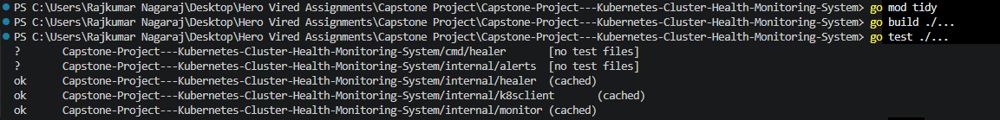

---


## Step 9 - Deploying the Updated Monitor

Start a fresh cluster, build the image, load it into Minikube and deploy:

```
minikube start --driver=docker --cpus 2 --memory 2200
minikube addons enable metrics-server
docker build -t health-monitor:latest .
minikube image load health-monitor:latest
kubectl apply -f deploy/manifests/rbac.yaml
kubectl apply -f deploy/manifests/health-monitor.yaml
kubectl apply -f deploy/prometheus/prometheus-deployment.yaml
kubectl apply -f deploy/prometheus/grafana-deployment.yaml
kubectl get pods
```

Wait until the health-monitor, prometheus and grafana pods show 1/1 Running.

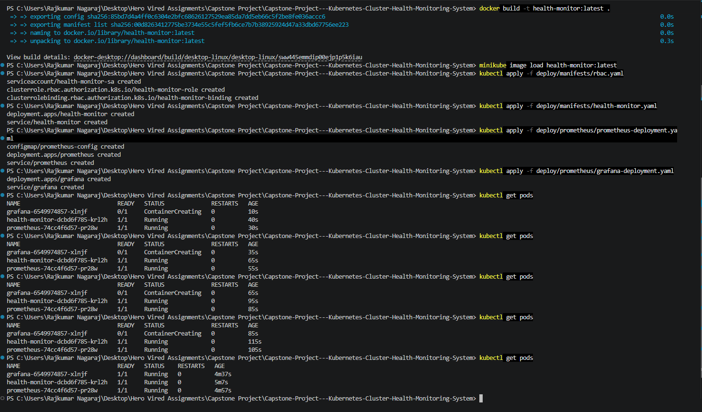

Verify that the monitor is allowed to delete pods:

```
kubectl auth can-i delete pods --as=system:serviceaccount:default:health-monitor-sa
```

The command prints `yes`.


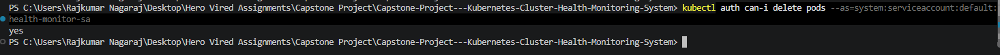

---


## Step 10 - Test 1: A Crash-Looping Pod

```
kubectl apply -f deploy/manifests/crashloop-test.yaml
kubectl get pods -w
```

The pod fails, restarts and enters CrashLoopBackOff. When its restart count reaches 3, the healer deletes it (the pod shows Terminating) and the Deployment creates a replacement with a new name and a restart count of 0. The replacement crashes in the same way and is healed in turn, so the cycle repeats.

In the test run the first pod reached CrashLoopBackOff with 3 restarts about 49 seconds after creation and was terminated 5 seconds later.

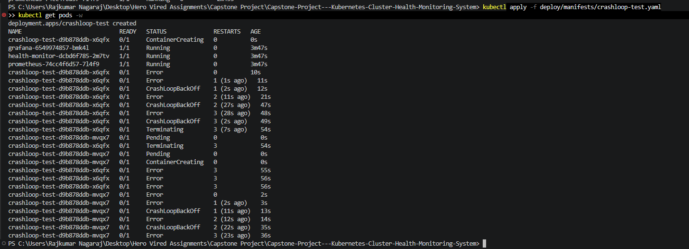


<b>Read the audit trail.</b> The filter is case-sensitive so that only healing lines match:

```
kubectl logs deploy/health-monitor | Select-String "HEAL action" -CaseSensitive
```

Example output from the test run:

```
2026/11/21 11:54:09 HEAL action=delete_pod ns=default pod=crashloop-test-d9b878ddb-x6qfx reason=CrashLoopBackOff
2026/11/21 11:58:29 HEAL action=delete_pod ns=default pod=crashloop-test-d9b878ddb-mvqx7 reason=CrashLoopBackOff
```

Each line records when the action happened, which pod was removed and why. The second line is the replacement pod being healed, which shows that recovery repeats.


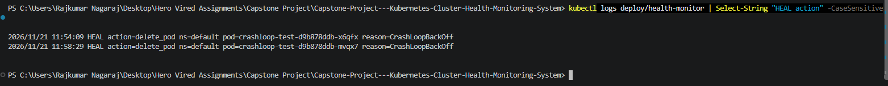

---


## Step 11 - Test 2: A Failed Job Pod

Remove the first test and create a pod that ends in the Failed phase:

```
kubectl delete -f deploy/manifests/crashloop-test.yaml
kubectl apply -f deploy/manifests/failed-job-test.yaml
kubectl get pods -w
```

The Job's pod shows Error. The healer deletes it and the Job controller creates a new pod, up to the Job's backoff limit of 2. The audit log then contains a healing line with reason=Failed.

```
kubectl logs deploy/health-monitor | Select-String "HEAL action" -CaseSensitive
```


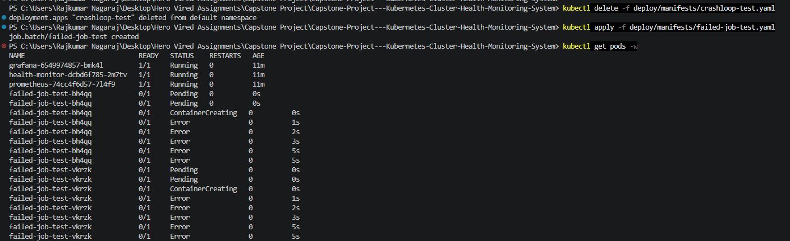

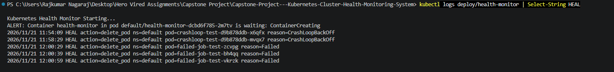

---


## Step 12 - Test 3: A Standalone Pod Is Left Alone

This is the safety check. A pod with no controller would never be recreated, so the healer must not delete it.

```
kubectl run solo --image=busybox:1.36 --restart=Never --command -- sh -c "exit 1"
```

After 30 to 40 seconds, check the pods and the log:

```
kubectl get pods
kubectl logs deploy/health-monitor --tail=10
```

The solo pod is still present with the status Error, and there is no healing line for it in the log.


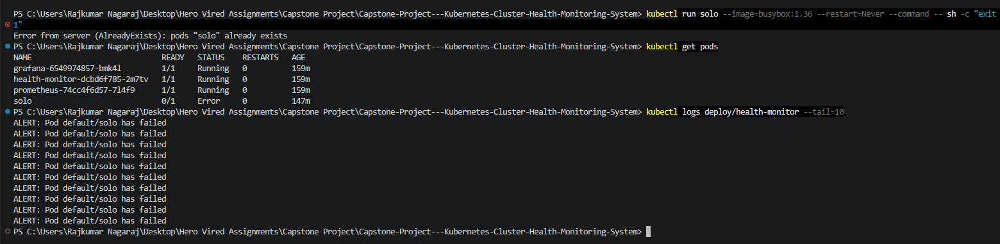

---


## Step 13 - Healing Metrics

Open the monitor's metrics endpoint:

```
kubectl port-forward svc/health-monitor 18080:8080
```

Browse to http://localhost:18080/metrics and search for healing_actions_total. The counter shows the number of actions per reason (CrashLoopBackOff and Failed). Local port 18080 is used because Windows blocked port 8080.


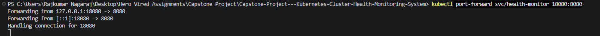

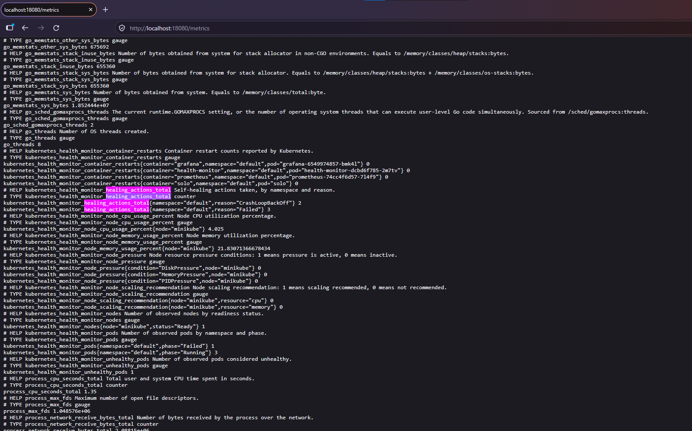

The same metric is available in Prometheus. With the Prometheus port-forward running, open its UI, go to the Graph tab and run:

```
kubernetes_health_monitor_healing_actions_total
```

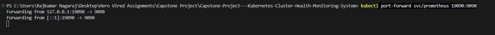

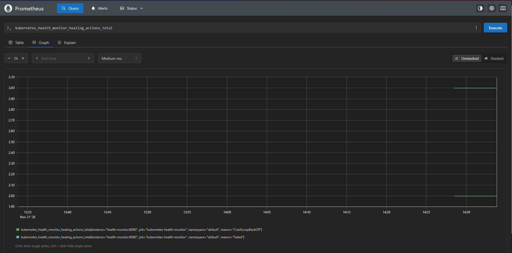

---


## Step 14 - Clean Up

```
kubectl delete -f deploy/manifests/failed-job-test.yaml
kubectl delete pod solo
```

---


## Limitations and Notes

- The healer watches the default namespace only.
- Healing means deleting the pod. Kubernetes cannot restart a pod in place, so the controller creates a replacement, which the scheduler may place on a different node. That is how workloads are rescheduled.
- If the cause of a crash is permanent, such as a bad image or a bug, the replacement crashes too and is healed again. The healer fixes transient failures. Persistent failures show up as repeated healing actions, which later sprints turn into alerts.
- Scaling and resource balancing are delivered in Sprint 4.

---


## Sprint 3 - Summary of Changes

| File | Change |
|---|---|
| internal/k8sclient/client.go | Added UnhealthyReason() and changed DeleteFailedControllerPod() to heal Failed, Evicted and crash-looping pods |
| internal/healer/healer.go | Heals by reason, logs every action with a timestamp and reason, and records the healing metric |
| internal/monitor/metrics.go | Added the kubernetes_health_monitor_healing_actions_total counter and RecordHealingAction() |
| cmd/healer/main.go | Calls the healer in every monitoring cycle |
| deploy/manifests/rbac.yaml | Added the delete verb for pods only |
| deploy/manifests/crashloop-test.yaml | New test Deployment that crash-loops |
| deploy/manifests/failed-job-test.yaml | New test Job whose pod fails |
| internal/k8sclient/client_test.go | Added TestUnhealthyReason |
| internal/healer/healer_test.go | Added a test for crash-looping pods |

<b>Result :</b> The system now recovers automatically from failed, evicted and crash-looping pods. Recovery is safe (controller-managed pods only, with UID checks), transparent (a timestamped audit log) and measurable (a Prometheus counter). It was verified on a local staging cluster with three tests: a crash-looping pod, a failed Job pod and a standalone pod that is correctly left alone.

---

<b></b>
<b></b>
<b></b>
<b></b>
